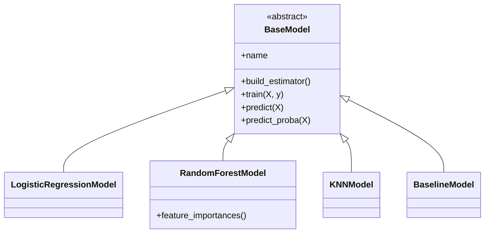
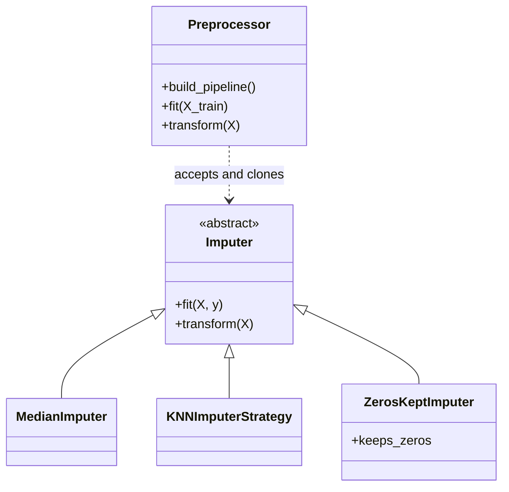
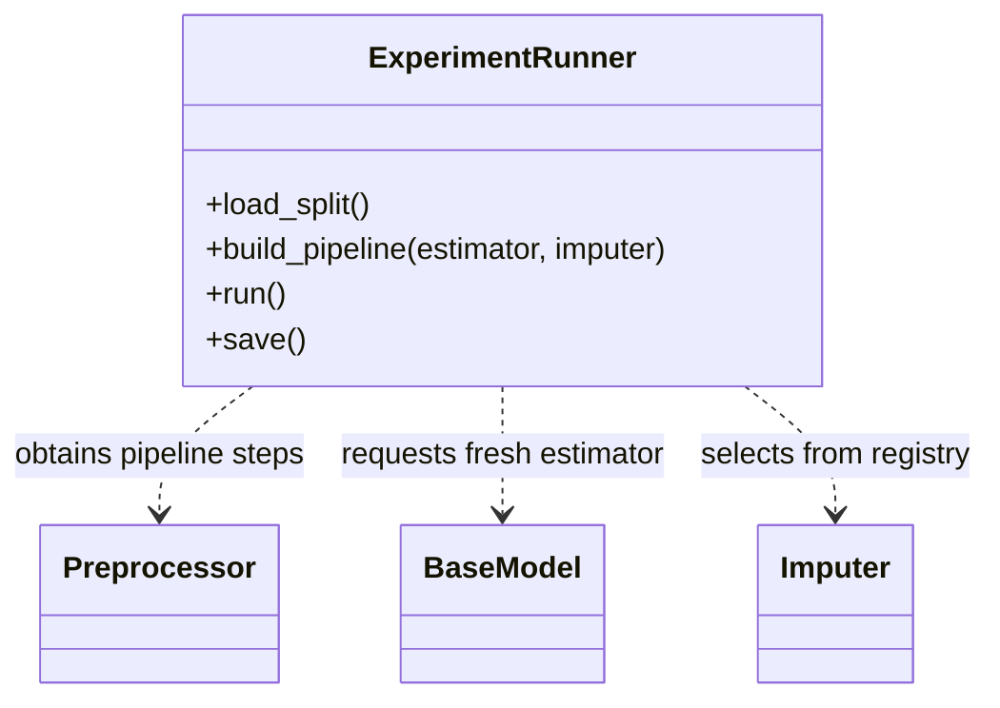

# OOP Mini Project Report

## 1. Introduction and objectives
<!-- D3: Define the diabetes prediction problem, state the objectives,
and explain how the team will evaluate success. -->

## 2. Team process, Kanban and Git
<!-- Co3: Explain how the team used the board, branches, and pull
requests. Link to examples of reviews, pairing, and conflict resolution. -->

## 3. Dataset
<!-- An1: Describe the data source, number of records, predictor variables,
and meaning of Outcome. Summarise the raw data and link to the EDA findings. -->

## 4–6. Data quality, cleaning, clean datasets, EDA
<!-- REP2: Summarise the quality checks, explain how missing measurements
were handled, describe the exported datasets, and interpret the EDA figures. -->

## 7. Software design, OOP
### 7.1 Design responsibilities

The software separates data preparation, prediction, tuning, evaluation
and experiment coordination. This allows a component to change without
requiring every other component to be rewritten. For example, median
imputation can be replaced with KNN imputation while retaining the same
classifier and evaluation metrics.

The diagrams below show selected project classes and their principal
relationships. Solid generalisation arrows represent inheritance;
dashed arrows represent use or dependency. They do not imply that one
component owns the lifetime of another.

### 7.2 Prediction model hierarchy

**Figure 7.1. Prediction models share the BaseModel interface.**

`BaseModel` defines an abstract `build_estimator()` method and provides
shared training and prediction operations. Each concrete subclass
constructs its corresponding scikit-learn estimator. The majority-class
`BaselineModel` provides a reference against which the predictive models
can be compared.

The wrappers and their estimators have distinct roles. Calling
`model.train(X, y)` fits the estimator stored inside a wrapper and updates
the wrapper's training flag. Prediction through the wrapper checks that
flag before proceeding. Its `predict_proba()` returns one probability
of class 1 per row.

By contrast, `build_estimator()` returns a fresh, unfitted scikit-learn
estimator. E2 places that estimator inside a Pipeline and fits the
pipeline directly. This does not train the wrapper itself. The pipeline
therefore uses the estimator's `fit()`, parameter and probability-matrix
interfaces rather than the wrapper's `train()` method.

This distinction supports scikit-learn cloning and parameter search
without claiming that the current wrappers themselves implement the
complete scikit-learn estimator interface.

### 7.3 Interchangeable imputation strategies

**Figure 7.2. Preprocessing accepts interchangeable imputation strategies.**

`Imputer` defines the common `fit()` and `transform()` contract.
`MedianImputer` learns column medians, while `KNNImputerStrategy` learns
from neighbouring training observations. Both can be supplied to the
same preprocessing workflow.

This is an application of the Strategy pattern: the preprocessing
component receives an imputation strategy rather than containing a
separate implementation for every possible method. The `IMPUTERS`
registry maps names to implementations, allowing experiment code to
select a strategy consistently.

The zeros-kept control is an important exception to the usual sequence.
Median and KNN workflows require:

`ZeroToNaN → StandardScaler → imputer → estimator`

The zeros-kept workflow requires:

`StandardScaler → ZerosKeptImputer → estimator`

`ZerosKeptImputer.keeps_zeros` signals that ZeroToNaN must be omitted.
Otherwise, the workflow would remove the zeros that this control is
intended to preserve. Pipeline construction must enforce this rule;
the presence of the attribute alone does not alter the pipeline.

### 7.4 Coordination and supporting components

**Figure 7.3. ExperimentRunner coordinates model and preprocessing components.**

`ExperimentRunner` reads the dataset, creates the stratified training/test
split, constructs pipelines, searches parameter grids and saves results.
The `MODELS` and `IMPUTERS` registries support iteration over configured
combinations.

The runner currently performs its search through scikit-learn
`GridSearchCV` directly. Although the project also defines
`HyperparameterTuner`, E2 does not currently call that class. Similarly,
E2 calculates its result metrics directly rather than calling the
project's `Evaluator`. These are opportunities for future consolidation,
not relationships represented as implemented in Figure 7.3.

Other project workflows use `Evaluator` to provide consistent metric
calculation, comparison tables and ROC plots. It supports both the
wrappers' one-dimensional positive-class probabilities and standard
classifier probability matrices.

`CleaningLog` records cleaning actions as numbered `LogEntry` objects.
Entries are frozen dataclass instances, and the public entries collection
is a tuple. These choices prevent ordinary external mutation of recorded
entries. A preprocessor can receive a log through its constructor;
however, E2 currently constructs its preprocessor without supplying one,
so preprocessing logging should not be assumed for every runner run.

### 7.5 OOP principles illustrated by the project

| Principle | Implementation | Project example |
| --- | --- | --- |
| Abstraction | Abstract model and imputer contracts | Every concrete model supplies `build_estimator()`. |
| Inheritance | Concrete classes extend shared base classes | Logistic regression, Random Forest and KNN inherit training and prediction behaviour from `BaseModel`. |
| Polymorphism | Components use shared operations on different implementations | Experiment code requests an estimator from each model without constructing every estimator itself. |
| Encapsulation | Fitted estimators and training state are managed through methods | Wrapper predictions reject use before training. Leading underscores indicate internal attributes rather than enforcing access restrictions. |
| Composition | Pipelines combine independent transformation and estimator objects | Scaling, imputation and classification form one fitted workflow. |
| Dependency injection | Collaborating objects are supplied to constructors | `Preprocessor` receives an imputer and an optional cleaning log. |

For example, changing from `MedianImputer` to `KNNImputerStrategy` changes
how missing measurements are filled without changing the prediction
model's interface. Changing from logistic regression to Random Forest
changes the estimator while preserving the overall pipeline structure.

### 7.6 Design, reproducibility and current limitations

The split precedes learned preprocessing. During cross-validation,
each complete pipeline is fitted on that fold's training portion.
Scaling statistics and imputation information therefore exclude the
validation portion. This protection depends on how objects are fitted;
the class hierarchy alone does not prevent data leakage.

X2 uses identical repeated validation splits across configurations and
keeps the held-out test set unused. E2 has a different role: it tunes
on training data and evaluates each resulting configuration once on the
held-out split. Its selected combination is marked using CV ROC-AUC,
not the test metrics. The displayed test comparisons must not be used
to repeatedly revise model selection.

The inspected E2 implementation has integration limitations requiring
team review:

- Its pipeline builder includes ZeroToNaN for the zeros-kept control.
- Its full KNN grid contains 28 combinations, exceeding the stated
  project limit of 20.
- Its search grids and metric calculations duplicate functionality
  available elsewhere in the project.
- It rounds CV scores before choosing the winning row, which can
  turn close scores into ties.
- The inspected models module contains two definitions named
  `BaselineModel`; Python binds that name to the later definition.

These limitations are documented separately from the intended design.
They should be resolved and retested before claiming that every
configuration in the complete workflow has been verified.

## 8. Machine-learning method
<!-- REP3: Describe the baseline, models, preprocessing order, tuning,
and evaluation. Explain which steps are fitted on training data. -->

## 9–10. Results, discussion, limitations
<!-- Co1: Present the model and imputation comparisons, interpret the
main differences, and explain the limits of what the results show. -->

## 11. Conclusion
<!-- REP3: Summarise the main finding in relation to the project objectives. -->

## 12. Contributions table
<!-- REP3: Record each member's contributions and link to the relevant
issues, commits, pull requests, or reviews. -->
