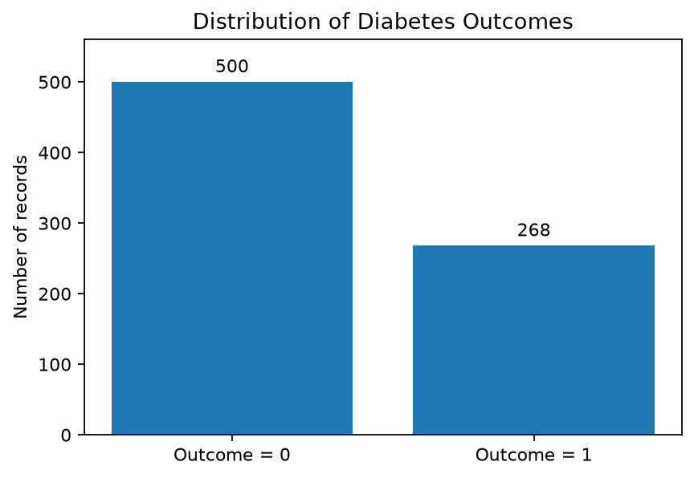
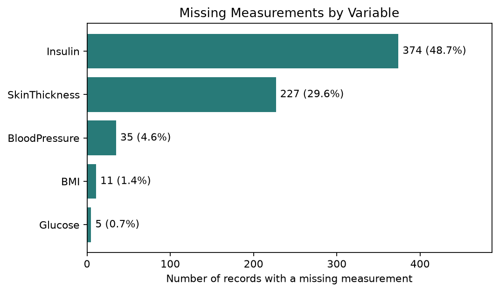
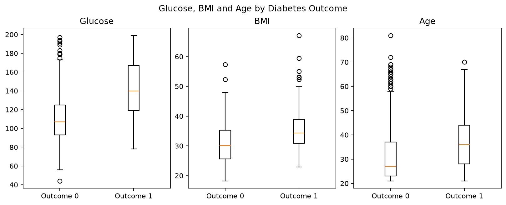
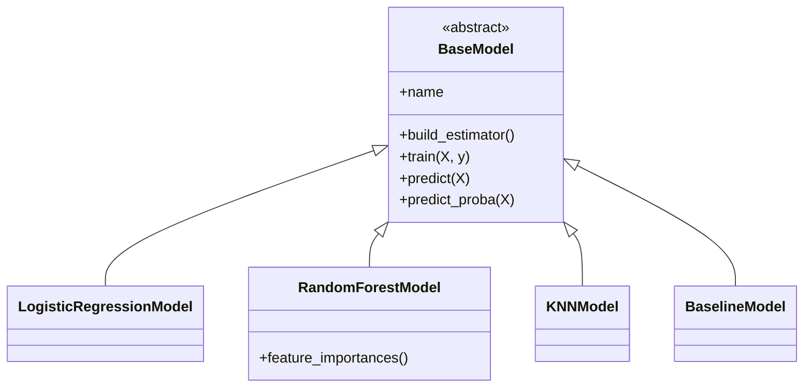
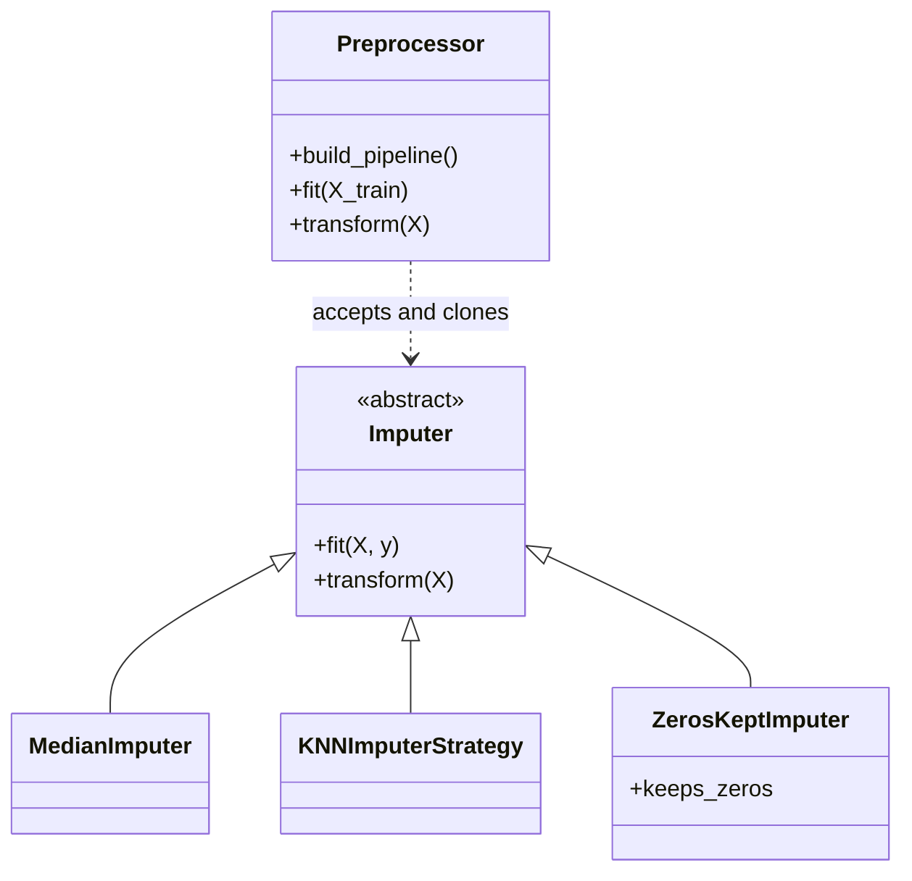
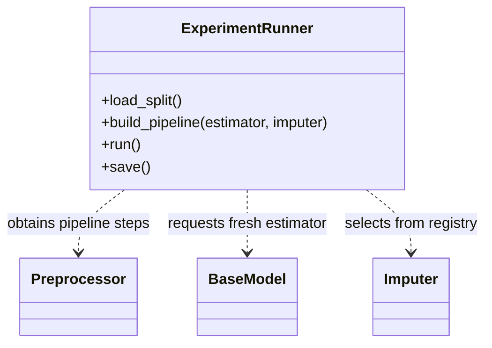

# OOP Mini Project Report

## 1. Introduction and objectives

### Problem statement

This project uses the eight predictors in the Pima diabetes dataset to
classify the recorded binary diabetes outcome (`Outcome`). In selected
measurement fields, recorded zeros are treated as missing. Because the
choice of imputation method can influence model performance, the project
compares median and k-nearest neighbours (KNN) imputation under the same
evaluation procedure.

### Objectives

1. Assess the quality of the raw data by identifying missing measurements
   and documenting values flagged by the validity and consistency checks.
2. Compare logistic regression, random forest, and KNN classifiers with
   a majority-class baseline.
3. Assess how median and KNN imputation affect each classifier by
   comparing them on identical validation splits.

### Success metrics

Use ROC-AUC as the primary metric for comparing how well models
distinguish positive from negative outcomes across classification
thresholds. Report accuracy, precision, recall, F1, and the confusion
matrix at the decision rule used to generate class predictions. Recall
shows the proportion of positive cases detected, while the false-negative
count shows how many positive cases the model missed.

Evaluate each model and imputation strategy on the same stratified
validation splits. Fit preprocessing and models using only the training
data within each split, then evaluate on the held-out data. Report the
mean and standard deviation of ROC-AUC across the validation splits.
Judge improvement by comparing each model with the majority-class
baseline and by examining the direction, size, and consistency of the
ROC-AUC differences between median and KNN imputation for the same
classifier. Interpret the ranking alongside recall and precision so
that any trade-offs in detecting positive cases are visible.

## 2. Team process, Kanban and Git
<!-- Co3: Explain how the team used the board, branches, and pull
requests. Link to examples of reviews, pairing, and conflict resolution. -->

## 3. Dataset
The Pima Indians Diabetes dataset (`data/diabetes.csv`) contains 768
records, eight predictors and one binary outcome. `Outcome = 0` denotes
a recorded negative outcome; `Outcome = 1` denotes a recorded positive
outcome. The [data dictionary](data_dictionary.md) describes the variables,
units and missing-value conventions.

### Exploratory analysis of the raw data

The raw CSV was loaded through the project's DataLoader. Zero placeholders
in Glucose, BloodPressure, SkinThickness, Insulin and BMI were treated as
missing measurements. Zero pregnancies remained valid. Zero placeholders
were excluded from the glucose and BMI comparisons.

1. **Uneven outcome groups:** 500 records (65.1%) had Outcome 0 and
   268 (34.9%) had Outcome 1.
2. **Missingness concentrated in two measurements:** Insulin had 374
   missing measurements (48.7%) and SkinThickness had 227 (29.6%).
   BloodPressure had 35, BMI had 11 and Glucose had 5.
3. **Higher median glucose in the positive group:** 140 for Outcome 1
   versus 107 for Outcome 0.
4. **Higher median BMI in the positive group:** 34.3 for Outcome 1
   versus 30.1 for Outcome 0.
5. **Higher median age in the positive group:** 36 years for Outcome 1
   versus 27 years for Outcome 0.

The negative outcome group contains almost twice as many records as
the positive group.

Insulin and SkinThickness account for most missing measurements.

Glucose, BMI and age differ between outcome groups, although these
descriptive differences do not establish causation.

Regenerate the figures from the repository root with `python -m src.eda`.
## Data quality, cleaning, clean datasets, EDA

### 4. Data quality assessment

This part checks the Pima dataset on six data quality dimensions before any cleaning. The checks were run with the project quality checker (completeness and uniqueness in C1, validity and consistency in C2, accuracy and timeliness in C3). The full output is in `docs/data_quality_report.md`. The meaning, unit and valid range of every column are in `docs/data_dictionary.md`.

#### 4.1 Results before cleaning

| Dimension | What was checked | Finding | Action |
| --- | --- | --- | --- |
| Completeness | Empty cells and hidden zeros | No empty cells, but 652 hidden zeros in five columns (10.6% of all feature values). Only 392 of 768 rows (51.0%) have no hidden zero. | Zeros in the five columns are treated as missing and imputed (part 5). |
| Validity | Values inside the allowed ranges, Outcome only 0 or 1 | No value outside the ranges in the data dictionary (hidden zeros excluded). Outcome contains only 0 and 1. | None needed. |
| Consistency | Data types, whole numbers, Pregnancies compared with Age | All nine columns are numeric, whole-number columns contain whole numbers, and Pregnancies is at most Age minus 10 in all 768 rows. | None needed. |
| Accuracy | Outliers (1.5 x IQR rule) and plausibility | Outliers flagged: Pregnancies 4, BloodPressure 14, SkinThickness 3, Insulin 24, BMI 8, DiabetesPedigreeFunction 29, Age 9, Glucose 0. The lowest non-zero BloodPressure is 24 mm Hg, which is unusual but inside the hard limits. | Outliers are flagged, not deleted, because none is physiologically impossible. |
| Uniqueness | Duplicate rows | 0 duplicate rows. The file has no patient ID, so it cannot show whether the same person appears twice. | A PatientID column is added in the clean datasets (part 6). |
| Timeliness | Age of the data | Collected in the late 1980s. The file has no date column, so this comes from the source documentation. | Stated as a limitation (4.4). |

#### 4.2 Hidden zeros

A value of 0 in Glucose, BloodPressure, SkinThickness, Insulin or BMI is not a real measurement, so it means "missing". The file has no empty cells, which is why the problem is hidden. Zeros in Pregnancies are valid (111 rows), because a patient can have had no pregnancies.

| Column | Rows with 0 | Share of 768 rows |
| --- | --- | --- |
| Glucose | 5 | 0.7% |
| BloodPressure | 35 | 4.6% |
| SkinThickness | 227 | 29.6% |
| Insulin | 374 | 48.7% |
| BMI | 11 | 1.4% |

Of the 768 rows, 376 (49.0%) have at least one hidden zero: 142 rows have one, 199 have two, 28 have three and 7 have four.

#### 4.3 Before and after cleaning

After imputation no missing value remains. The table shows what the zeros did to the data, using median imputation as an illustration. The medians are computed on all 768 rows here only to describe the data. In the models they are computed from the training data alone.

| Column | Median used | Mean with zeros | Mean after median fill | SD with zeros | SD after median fill |
| --- | --- | --- | --- | --- | --- |
| Glucose | 117 | 120.9 | 121.7 | 32.0 | 30.4 |
| BloodPressure | 72 | 69.1 | 72.4 | 19.4 | 12.1 |
| SkinThickness | 29 | 20.5 | 29.1 | 16.0 | 8.8 |
| Insulin | 125 | 79.8 | 140.7 | 115.2 | 86.4 |
| BMI | 32.3 | 32.0 | 32.5 | 7.9 | 6.9 |

The zeros pull the averages down and inflate the spread, most of all for Insulin and SkinThickness. Left in place they would give the models false information, which is why the project compares repairing them with leaving them alone (part 5).

#### 4.4 Limitations of the checks

- Accuracy can only be judged by plausibility, because the original patient records are not available.
- The data was collected in the late 1980s from women of Pima Indian heritage aged 21 or older, so the results may not apply to other populations, countries or years.
- With no patient ID, uniqueness is only ed on whole rows.

### 5. Data cleaning and imputation

#### 5.1 Approach

The cleaning follows the data quality findings in part 4. Hidden zeros in Glucose, BloodPressure, SkinThickness, Insulin and BMI are converted to missing values and then filled by an imputer. Zeros in Pregnancies are left alone. The project compares three ways of handling the zeros, so that the effect of the choice can be measured:

| Method | What it does |
| --- | --- |
| Median imputation | Replaces each missing value with the median of that column in the training data. The median is not pulled by very large values, which matters for Insulin. |
| KNN imputation | Replaces each missing value using the 5 most similar patients in the training data. The columns are scaled first so that Insulin, which has the largest numbers, does not dominate the distances. |
| Zeros kept (control) | Leaves the zeros in the data as they are, to show what happens when they are not repaired. This pipeline skips the zero-to-missing step. |

A majority-class baseline model, which always predicts the most common outcome, gives a second reference point.

#### 5.2 Order of steps and prevention of data leakage

1. The data is split first: 80% training and 20% test (614 and 154 patients), stratified on Outcome, with `random_state` 42.
2. All other steps run inside one scikit-learn pipeline: zero-to-missing, scaling, imputation, then the model.
3. Every step learns only from the training data. During cross-validation and tuning, each fold fits the scaler and the imputer on its own training part, so the validation part never influences them. The test set is used once, at the end.

#### 5.3 Outliers

Outliers are flagged with the 1.5 x IQR rule but not deleted, unless a value is physiologically impossible. None of the flagged values was impossible, so no row was removed.

#### 5.4 Cleaning log

Every cleaning action is recorded by the CleaningLog class in `docs/cleaning_log.csv`. A summary of the main actions on the full dataset:

| Dimension | Column | Action | Rows affected |
| --- | --- | --- | --- |
| Completeness | Glucose | Zeros converted to missing, then imputed | 5 |
| Completeness | BloodPressure | Zeros converted to missing, then imputed | 35 |
| Completeness | SkinThickness | Zeros converted to missing, then imputed | 227 |
| Completeness | Insulin | Zeros converted to missing, then imputed | 374 |
| Completeness | BMI | Zeros converted to missing, then imputed | 11 |
| Uniqueness | All columns | Duplicate rows searched; none found, none removed | 0 |
| Validity | All columns | Values outside valid ranges searched; none found | 0 |
| Accuracy | Eight columns | Outliers flagged, none deleted | see 4.1 |

### 6. Clean datasets and exploratory analysis

#### 6.1 Clean datasets

Two clean copies of the data are produced for description and inspection, one with median imputation and one with KNN imputation:

- `data/processed/diabetes_median_clean.csv`
- `data/processed/diabetes_knn_clean.csv`

Each has 768 rows and no missing values. They are made by scaling, imputing and then converting the values back to their original units. Each file has an added PatientID column and flag columns that mark which values were filled in. The models do not read these files. They repeat the imputation inside the pipeline using training data only, so no information leaks from the test set.

#### 6.2 Exploratory analysis

- **Outcome balance:** 500 patients without diabetes and 268 with it, so 34.9% are positive. Accuracy alone would be misleading, so recall and ROC-AUC are the main metrics.
- **Age:** patients are aged 21 to 81, with a median of 29.
- **Group differences (medians):** Glucose is 140 in patients with diabetes and 107 in those without. BMI is 34.3 and 30.1. Age is 36 and 27.

Correlation of each feature with Outcome (hidden zeros treated as missing):

| Feature | Correlation with Outcome |
| --- | --- |
| Glucose | 0.49 |
| BMI | 0.31 |
| Insulin | 0.30 |
| SkinThickness | 0.26 |
| Age | 0.24 |
| Pregnancies | 0.22 |
| BloodPressure | 0.17 |
| DiabetesPedigreeFunction | 0.17 |

Glucose has the strongest link with the outcome. The two strongest links between features are BMI with SkinThickness (0.65) and Glucose with Insulin (0.58). Correlation does not show cause.

#### 6.3 What this means for the models

The hidden zeros are concentrated in Insulin and SkinThickness, which is where the imputation choice should matter most. Glucose is the strongest predictor. Because only about a third of patients are positive, the models are judged on recall and ROC-AUC as well as accuracy.

## 7. Software design, OOP
### 7.1 Design responsibilities

The software separates data preparation, prediction, tuning, evaluation
and experiment coordination. This allows a component to change without
requiring every other component to be rewritten. For example, median
imputation can be replaced with KNN imputation while retaining the same
classifier and evaluation metrics.

The diagrams below show selected project classes and their principal
relationships. Solid generalisation arrows represent inheritance;
dashed arrows represent use or dependency. They do not imply that one
component owns the lifetime of another.

### 7.2 Prediction model hierarchy

**Figure 7.1. Prediction models share the BaseModel interface.**

`BaseModel` defines an abstract `build_estimator()` method and provides
shared training and prediction operations. Each concrete subclass
constructs its corresponding scikit-learn estimator. The majority-class
`BaselineModel` provides a reference against which the predictive models
can be compared.

The wrappers and their estimators have distinct roles. Calling
`model.train(X, y)` fits the estimator stored inside a wrapper and updates
the wrapper's training flag. Prediction through the wrapper checks that
flag before proceeding. Its `predict_proba()` returns one probability
of class 1 per row.

By contrast, `build_estimator()` returns a fresh, unfitted scikit-learn
estimator. E2 places that estimator inside a Pipeline and fits the
pipeline directly. This does not train the wrapper itself. The pipeline
therefore uses the estimator's `fit()`, parameter and probability-matrix
interfaces rather than the wrapper's `train()` method.

This distinction supports scikit-learn cloning and parameter search
without claiming that the current wrappers themselves implement the
complete scikit-learn estimator interface.

### 7.3 Interchangeable imputation strategies

**Figure 7.2. Preprocessing accepts interchangeable imputation strategies.**

`Imputer` defines the common `fit()` and `transform()` contract.
`MedianImputer` learns column medians, while `KNNImputerStrategy` learns
from neighbouring training observations. Both can be supplied to the
same preprocessing workflow.

This is an application of the Strategy pattern: the preprocessing
component receives an imputation strategy rather than containing a
separate implementation for every possible method. The `IMPUTERS`
registry maps names to implementations, allowing experiment code to
select a strategy consistently.

The zeros-kept control is an important exception to the usual sequence.
Median and KNN workflows require:

`ZeroToNaN → StandardScaler → imputer → estimator`

The zeros-kept workflow requires:

`StandardScaler → ZerosKeptImputer → estimator`

`ZerosKeptImputer.keeps_zeros` signals that ZeroToNaN must be omitted.
Otherwise, the workflow would remove the zeros that this control is
intended to preserve. Pipeline construction must enforce this rule;
the presence of the attribute alone does not alter the pipeline.

### 7.4 Coordination and supporting components

**Figure 7.3. ExperimentRunner coordinates model and preprocessing components.**

`ExperimentRunner` reads the dataset, creates the stratified training/test
split, constructs pipelines, searches parameter grids and saves results.
The `MODELS` and `IMPUTERS` registries support iteration over configured
combinations.

The runner currently performs its search through scikit-learn
`GridSearchCV` directly. Although the project also defines
`HyperparameterTuner`, E2 does not currently call that class. Similarly,
E2 calculates its result metrics directly rather than calling the
project's `Evaluator`. These are opportunities for future consolidation,
not relationships represented as implemented in Figure 7.3.

Other project workflows use `Evaluator` to provide consistent metric
calculation, comparison tables and ROC plots. It supports both the
wrappers' one-dimensional positive-class probabilities and standard
classifier probability matrices.

`CleaningLog` records cleaning actions as numbered `LogEntry` objects.
Entries are frozen dataclass instances, and the public entries collection
is a tuple. These choices prevent ordinary external mutation of recorded
entries. A preprocessor can receive a log through its constructor;
however, E2 currently constructs its preprocessor without supplying one,
so preprocessing logging should not be assumed for every runner run.

### 7.5 OOP principles illustrated by the project

| Principle | Implementation | Project example |
| --- | --- | --- |
| Abstraction | Abstract model and imputer contracts | Every concrete model supplies `build_estimator()`. |
| Inheritance | Concrete classes extend shared base classes | Logistic regression, Random Forest and KNN inherit training and prediction behaviour from `BaseModel`. |
| Polymorphism | Components use shared operations on different implementations | Experiment code requests an estimator from each model without constructing every estimator itself. |
| Encapsulation | Fitted estimators and training state are managed through methods | Wrapper predictions reject use before training. Leading underscores indicate internal attributes rather than enforcing access restrictions. |
| Composition | Pipelines combine independent transformation and estimator objects | Scaling, imputation and classification form one fitted workflow. |
| Dependency injection | Collaborating objects are supplied to constructors | `Preprocessor` receives an imputer and an optional cleaning log. |

For example, changing from `MedianImputer` to `KNNImputerStrategy` changes
how missing measurements are filled without changing the prediction
model's interface. Changing from logistic regression to Random Forest
changes the estimator while preserving the overall pipeline structure.

### 7.6 Design, reproducibility and current limitations

The split precedes learned preprocessing. During cross-validation,
each complete pipeline is fitted on that fold's training portion.
Scaling statistics and imputation information therefore exclude the
validation portion. This protection depends on how objects are fitted;
the class hierarchy alone does not prevent data leakage.

X2 uses identical repeated validation splits across configurations and
keeps the held-out test set unused. E2 has a different role: it tunes
on training data and evaluates each resulting configuration once on the
held-out split. Its selected combination is marked using CV ROC-AUC,
not the test metrics. The displayed test comparisons must not be used
to repeatedly revise model selection.

The inspected E2 implementation has integration limitations requiring
team review:

- Its pipeline builder includes ZeroToNaN for the zeros-kept control.
- Its full KNN grid contains 28 combinations, exceeding the stated
  project limit of 20.
- Its search grids and metric calculations duplicate functionality
  available elsewhere in the project.
- It rounds CV scores before choosing the winning row, which can
  turn close scores into ties.
- The inspected models module contains two definitions named
  `BaselineModel`; Python binds that name to the later definition.

These limitations are documented separately from the intended design.
They should be resolved and retested before claiming that every
configuration in the complete workflow has been verified.

## 8. Machine-learning method
1. **Task:** binary classification of `Outcome` (diabetes: yes or no) from 8 clinical measurements.
2. **Split:** a stratified 80/20 split, giving 614 training patients and 154 test patients, with `random_state=42`. The test patients were not used for any tuning or choice.
3. **Pipeline:** `ZeroToNaN` (impossible zeros become missing), `StandardScaler`, imputer (median or KNN with 5 neighbours), then the model. All steps sit in one scikit-learn Pipeline and are fitted on the training rows only, so no information from validation or test rows reaches the imputer or scaler. Scaling comes before imputation because KNN imputation uses distances.
4. **Baseline:** a majority-class baseline (always predicts no diabetes; ROC-AUC 0.5). A zeros-kept control was planned but was not part of the final run.
5. **Imputer comparison:** repeated stratified 5-fold cross-validation (3 repeats), the same folds for every pipeline, default hyperparameters.
6. **Tuning:** grid search with 5-fold stratified cross-validation on the training set only, scored by ROC-AUC. The grids were:
   - Logistic regression: `C` in 0.01, 0.1, 1, 10, 100.
   - Random forest: `n_estimators` in 100, 200; `max_depth` in none, 5, 10; `min_samples_leaf` in 1, 3, 5.
   - KNN: `n_neighbors` in 3, 5, 7, 9, 11, 15, 21; `weights` uniform or distance; `p` 1 or 2.
7. **Final model:** the model and imputer with the best cross-validation ROC-AUC (not the best test score), evaluated once on the test set. Every combination was also scored once on the test set and saved to `results/final_test.csv`.
8. **Interpretation:** random forest feature importances (`RandomForestModel.feature_importances`) and the correlation analysis in `docs/figures/eda_notes.md`.

## Results, discussion, limitations
<!-- Co1: Present the model and imputation comparisons, interpret the
main differences, and explain the limits of what the results show. -->

### 9. Results

#### 9.1 Imputer comparison by cross-validation

Every combination of imputer and model was compared with repeated stratified 5-fold cross-validation (3 repeats, 15 folds in total) on the 614 training patients. All pipelines used the same folds and default model settings, and every step was fitted on the training part of each fold only. The test set was not used. Each cell shows the mean over the 15 folds, with the standard deviation (SD) in brackets.

| Model | Imputer | Accuracy | Recall | ROC-AUC |
| --- | --- | --- | --- | --- |
| Logistic regression | Median | 0.783 (0.035) | 0.575 (0.081) | 0.843 (0.027) |
| Logistic regression | KNN | 0.784 (0.031) | 0.580 (0.070) | 0.843 (0.025) |
| Logistic regression | Zeros kept | 0.782 (0.037) | 0.578 (0.064) | 0.831 (0.041) |
| Random forest | Median | 0.755 (0.035) | 0.584 (0.063) | 0.818 (0.039) |
| Random forest | KNN | 0.750 (0.043) | 0.580 (0.066) | 0.824 (0.034) |
| Random forest | Zeros kept | 0.758 (0.038) | 0.563 (0.079) | 0.816 (0.043) |
| KNN | Median | 0.759 (0.048) | 0.609 (0.053) | 0.807 (0.049) |
| KNN | KNN | 0.760 (0.041) | 0.617 (0.054) | 0.815 (0.042) |
| KNN | Zeros kept | 0.745 (0.032) | 0.552 (0.072) | 0.786 (0.045) |
| Majority-class baseline | Any | 0.651 (0.002) | 0.000 (0.000) | 0.500 (0.000) |

The baseline does not use the features, so its result is the same for every imputer.

Difference in mean ROC-AUC between KNN imputation and median imputation: logistic regression +0.001, random forest +0.006, KNN model +0.008. The SDs are 0.025 to 0.049, so every difference is much smaller than the SD. Following the rule set in the project plan, this is reported as no clear difference. The differences in recall (+0.005, -0.005 and +0.008) are also far inside the SD.

Difference in mean ROC-AUC between zeros kept and median imputation: logistic regression -0.012, random forest -0.002, KNN model -0.022. For recall the differences are +0.003, -0.022 and -0.057. Keeping the zeros gave a lower ROC-AUC for all three models, but every difference is smaller than the SD.

*Figure 1. Mean ROC-AUC and recall of each model and imputer in repeated cross-validation. The bars show one standard deviation. The baseline (ROC-AUC 0.50, recall 0.00) is below the scale.*

#### 9.2 Final test results

The best settings for each model and imputer were chosen by 5-fold cross-validation on the training data, scored by ROC-AUC, and never by test results. Each tuned model was then evaluated once on the 154 test patients (54 with diabetes and 100 without). The zeros-kept control was compared in cross-validation only (Section 9.1). The model marked with an asterisk had the best cross-validation score (0.8445) of all combinations.

| Model | Imputer | Best settings | Accuracy | Precision | Recall | F1 | ROC-AUC |
| --- | --- | --- | --- | --- | --- | --- | --- |
| Logistic regression * | Median | C = 0.1 | 0.688 | 0.565 | 0.481 | 0.520 | 0.810 |
| Logistic regression | KNN | C = 0.1 | 0.701 | 0.587 | 0.500 | 0.540 | 0.812 |
| Random forest | Median | 200 trees, depth 5, leaf size 5 | 0.747 | 0.674 | 0.537 | 0.598 | 0.806 |
| Random forest | KNN | 200 trees, depth 5, leaf size 3 | 0.714 | 0.614 | 0.500 | 0.551 | 0.805 |
| KNN | Median | 21 neighbours, distance weights, p = 2 | 0.753 | 0.682 | 0.556 | 0.612 | 0.812 |
| KNN | KNN | 21 neighbours, distance weights, p = 2 | 0.747 | 0.667 | 0.556 | 0.606 | 0.803 |
| Majority-class baseline | Any | none | 0.649 | 0.000 | 0.000 | 0.000 | 0.500 |

The baseline predicts "no diabetes" for everyone. It is right for 100 of 154 patients (64.9%) and finds none of the 54 patients with diabetes, so any useful model has to beat 64.9% accuracy and 0.5 ROC-AUC.

All results were produced with fixed random seeds (42 for the split, the cross-validation and the random forest). The settings and a checksum of `data/diabetes.csv` are saved with the results files, so the run can be repeated.

### 10. Discussion

#### 10.1 Does the way the hidden zeros are handled matter?

Repairing the zeros with the median or with KNN made no clear difference. In cross-validation the mean ROC-AUC differed by at most 0.008 between the two methods, which is far less than the spread between folds (SD 0.025 to 0.049). On the test set there was no consistent pattern either: KNN imputation was slightly better for logistic regression (accuracy 0.701 against 0.688) but worse for the random forest (0.714 against 0.747) and for the KNN model (0.747 against 0.753). The simple median is therefore as good as the more complex KNN imputation here.

Leaving the zeros in place was the weakest option. It lowered the mean ROC-AUC for all three models, most of all for the KNN model (0.786 against 0.807), whose recall fell from 0.609 to 0.552. This fits the fact that KNN works from distances between patients, so false zeros in Insulin (48.7% of rows) and SkinThickness (29.6%) distort which patients look similar. Every gap is smaller than the SD, however, so the result is suggestive, not proven.

#### 10.2 Which model performed best?

In cross-validation logistic regression scored highest on ROC-AUC (0.843) and accuracy (0.784) and had the smallest SD in ROC-AUC (0.025 to 0.027). Random forest (0.818 to 0.824) and KNN (0.807 to 0.815) were 0.02 to 0.04 lower, about one SD, so logistic regression is the best-supported model but not by a wide margin. The KNN model had the highest recall (0.609 to 0.617). All three models were far above the baseline (ROC-AUC 0.50, accuracy 0.651).

The test set did not point to a different clear winner. All six tuned combinations lie within 0.009 ROC-AUC of each other (0.803 to 0.812). Logistic regression with median imputation, the combination chosen by cross-validation, had the lowest test accuracy (0.688), while the KNN model with median imputation had the highest (0.753) and the best F1 (0.612). The gap of 0.065 in accuracy is 10 of 154 patients. Cross-validation uses 614 patients and 15 folds, while the test set is one split of 154 patients, so the cross-validation result is the more reliable guide. The test result is reported as the final check and was not used to change any choice.

All models scored lower on the test set than in cross-validation (ROC-AUC 0.80 to 0.81 against 0.83 to 0.84 in tuning). A small drop is expected, because the settings were chosen on the training data and one test split varies by chance.

#### 10.3 Recall against accuracy

About one patient in three has diabetes (34.9%), so accuracy alone is misleading: the baseline reaches 64.9% without finding a single patient with diabetes. In screening, missing a patient with diabetes costs more than a false alarm, so recall and ROC-AUC matter most. By this measure the models are only moderate. The best recall in cross-validation was 0.617, so about 4 in 10 patients with diabetes were missed. On the test set the best recall was 0.556, which is 30 of 54 patients found and 24 missed.

The model with the best accuracy and ROC-AUC (logistic regression) is not the one with the best recall (KNN), so the choice depends on the goal. A screening tool that favours recall could lower its decision threshold to find more patients, at the price of more false alarms. This was not tested in this project.

## 11. Conclusion  
The team built a reusable object-oriented pipeline in Python (data loader, quality checker, cleaning log, interchangeable imputers, preprocessor, models, tuner, evaluator and experiment runner) and used it to ask whether median or KNN imputation of the hidden zeros changes prediction quality in the Pima diabetes data. The best combination by cross-validation was logistic regression with median imputation (cross-validated ROC-AUC 0.8445), which scored a ROC-AUC of 0.810 and a recall of 0.48 on the 154 test patients, against 0.50 for the majority-class baseline. The imputation method made no practical difference: for each of the three models, median and KNN imputation differed by at most 0.0024 in cross-validated ROC-AUC, and the winning combination beat its closest rival by only 0.0001, so the evidence does not show that either method is better. The main limitations are that the data are small, come from one population and were collected in the 1980s, so differences of one or two points on 154 patients are not reliable, and that at the default threshold every model found only 48% to 56% of the patients with diabetes, which is too low for screening, so the models are not for clinical use. Working with Kanban, one branch per card, pull requests and peer review gave each member visible, equal work (12 cards each), and taught the team that fixing the order of the pipeline steps early, and keeping every imputer and model behind one interface, made the comparison fair and the work easy to split.

## 12. Contributions

Each member completed 12 cards worth 22 points. All counts come from GitHub.

| Member | Cards | PRs merged | Reviews given | Commits |
|---|---|---|---|---|
| Shepard | D1, I1, C1, CL1, C6, Q1, M1, An2, T3, E2, REP3, Co3 | 12 | 2 | 39 |
| Bhekumuzi | D2, I2, Q4, C2, C4, W1, M2, Q2, X1, T1, REP2, Co1 | 13 | 6 | 37 |
| Nicole | D3, IF1, C3, An1, C5, E1, M3, CL2, T2, Q3, X2, Co2 | 13 | 8 | 28 |

Commit counts are from `git shortlog -sn --no-merges origin/develop`, taken on 20 November 2026.
